# W0 / 8A — Implementation Master Plan

| Field | Value |
|---|---|
| Delivery wave | **W0 — Implementation Master Plan and Visual Architecture Atlas** (document identity "Phase 8A" kept for continuity; owner decision OD-W0-R1) |
| Date | 2026-10-16 (first submission); revised 2026-10-16 after the first independent review (NOT APPROVED: P0 = 0, P1 = 5, Minor = 4); revised again after the second independent review (NOT APPROVED: P0 = 0, P1 = 2, Minor = 4); revised a third time after the third independent review (NOT APPROVED: P0 = 0, P1 = 1, Minor = 1); revised a fourth time after the fourth independent review (NOT APPROVED: P0 = 0, P1 = 1, Minor = 2) — every change is listed in the [Review-resolution ledger](W0-8A-Review-Resolution-Ledger.md) |
| Status | Submitted for independent freeze-gate re-review. **Not approved.** This plan approves no packet, opens no gate, accepts no risk, authorizes no migration and starts no implementation. |
| Baseline | Commit `de1cb27` ("phase 7 approved"), clean tree; Phases 1–7 (7A–7L) and D0 approved/frozen |
| Files of W0 | This plan · [Architecture Atlas](W0-8A-Architecture-Atlas.md) and [six diagrams](atlas/) · [First-Call Blueprint](W0-8A-First-Inbound-Call-Blueprint.md) · [Contract and Gate Register](W0-8A-Contract-and-Gate-Register.md) · [Solo-Developer Playbook](W0-8A-Solo-Developer-Playbook.md) |
| Not restated | Frozen architecture is cited by section and rule ID, never copied |

## 1. Verified baseline (read-only commands, executed 2026-10-16)

| Check | Result |
|---|---|
| Git | Branch `main`, head `de1cb27`, `git status --porcelain` empty, 834 tracked files |
| SQL migrations | 112 files `001_5B.sql` … `112_5H5.sql`; no file starting `113` |
| Alembic | 112 revision files; 112 distinct `revision` values; one root (`001_5B`, `down_revision = None`); sole head **`112_5H5`** |
| Phase 7 | 12 files 7A … 7L; 7L packet IDs AP-7L-01 … -54 (54); gates AG-7L-01 … -09 (9), all `CLOSED` |
| D0 code | `backend/voice_agent/{apps/api, platform/{config, infrastructure/{db,cache,observability}, shared_kernel, utils}}`, `scripts/{db_migrate,check_repository,verify}.py`, tests `unit/integration/smoke/support`, CI `backend-ci.yaml`, `deployment-schema-gate.yaml`, `infra/docker/api.Dockerfile`, Compose (PostgreSQL 18 + pgvector, one Redis 7.2) |
| Not present | `backend/voice_agent/modules/`, `apps/voice_gateway`, `apps/worker`, `frontend/`, any relay/consumer/gateway/finalizer, any migration after 112 |
| Integrity method | SHA-256 of all 833 tracked files under `docs/`, `backend/`, `infra/`, `.github/` taken before authoring and compared after (§13.2) |
| D0 evidence gaps carried | Docker/Compose and GitHub Actions jobs never executed on a runner (D0 findings §5) |

## 2. Governance and roadmap reconciliation

### 2.1 Owner decisions recorded for this plan (2026-10-16, written)

| ID | Decision | Where applied |
|---|---|---|
| OD-W0-R1 | No new architecture phases 8–24. Delivery uses **W0–W6**; engineering uses **D0–D10** (owner-supplied definitions, §3). D streams overlap; their numbers are not an execution order. W0 keeps the "Phase 8A" identity. Frozen roadmap and documents are not edited to reconcile numbering | §2.2, §3 – §5 |
| OD-W0-R2 | Exotel (+ number), Deepgram, ElevenLabs and one approved LLM provider will be set up by the owner. Until verified access exists, account-dependent work is **PENDING OWNER SETUP**; independent work continues. No secret in documentation, logs or repository | §8, §9; Blueprint §2, §7; Playbook §7 |
| OD-W0-R3 | Solo development does not lower any enterprise standard; optimize sequencing and automation only | Whole plan; §11 |
| OD-W0-R4 | After independent W0 approval, implementation starts with the first READY work package; no further documentation-only phase; as-built notes kept alongside code | §8; Playbook §1 |
| **OD-W0-08** (approved 2026-10-16, option A1) | M1 keeps crash-after-ACK callback recovery: 7H CBK-04/-05/-10 durable processing contract; 7I KEY-01 … KEY-10 and CBI-01 … CBI-14; **managed cloud KMS** with regional and environment separation, production and non-production keys isolated, India-region residency supported; ingress encrypt-only, processing decrypt-only; no raw payload by default; receipt + encrypted input commit atomically before the 2xx; failed encryption or persistence prevents a 2xx; crash, stale-claim, idempotency and key-rotation tests required; MR-7H-09 and the governed security/database changes recorded as prerequisites; no provisional M1 | Blueprint §2 P-10, P-11, §3.1 – §3.2, E-02a … E-02d, E-15, E-17; Register §4; W2-D2-02, W2-D9-04, W2-D9-02, W2-D6-09 |
| **OD-W0-09** (approved 2026-10-16, option A) | `CONCURRENT_CALLS` reservations in a governed, Billing-owned **PostgreSQL** relation; reservation identity = `call_session_id`; per-(organization, metric) serialization with the exact 6K §54.3 – §54.6 check including fractional limits; one pool for inbound and outbound; idempotent acquire and release; survives crashes and restarts; reconciler on authoritative PostgreSQL call and dispatch state; orphan reclaim after the bounded setup grace; never premature release of `SUBMITTING` / `AMBIGUOUS` dispatches; fail closed; Redis is not the V1 authority | Blueprint P-5, §3.3, E-16; Register W0-MR-01; W2-D2-03, W2-D3-06 |
| **OD-W0-10** (approved 2026-10-16, option A) | LS-D-VOX stays `CLOSED` until all six owed groups are implemented, verified and admitted; no partial admission; no removal of obligations; no publication of production-bound Voice events to a partially admitted stream; unfinished consumers tested only in isolated, disposable conformance environments; fully admitted streams may proceed under 7L rules; **no synthetic staging exception** | §5 W3; §9 W3; Register §3 AG-7L-06, §5 staging row; Atlas A3, A4, A6 |
| **OD-W0-11** (approved 2026-10-16, option A) | Voice-owned inbound provider-call identity relation, unique `(organization_id, provider_slug, provider_call_ref)` with the provider's stable call identifier (not a callback event ID); one canonical `call_session_id` per provider call, across `started_at` partitions; concurrency-safe and crash-recoverable binding; RLS, guarded grants, provider-specific normalization; duplicates reuse the existing session and take no further reservation; not reliant on advisory locks, lookups or the non-unique index; distinct from receipt dedup; concurrent-callback, retry, crash, tenant-isolation and partition-boundary tests | Blueprint P-12, §3.3, E-16; Register W0-MR-02; W2-D2-04, W2-D6-02. Recorded as new finding NF-01 |
| Boundary of OD-W0-08 … -11 | They approve the architecture and planning direction only. **They do not authorize database modification or implementation**, and they do not decide OD-W0-01 or any other open decision | §12.1 (OD-W0-12, -13) |

### 2.2 Frozen roadmap numbering versus W/D

`docs/product/PROJECT_ROADMAP.md` (frozen) lists Phases 1–24. AIR §31, 7K §30.2 and 7L §31 cite its implementation phases as destinations (P7 … P24). Per OD-W0-R1 those labels are **kept as traceability references in the frozen documents** and are not used as delivery phases. The exact differences:

| Frozen roadmap phase | How the W/D plan delivers it | Difference |
|---|---|---|
| P7 Event Architecture (and 7L's "P7 event infrastructure build") | D4 (W1 producer side, W3 relay/consumers), D5 (W3), D9 (W3–W6 gates) | Built incrementally, not as one phase; production activation only in W6 |
| P8 Authentication & Authorization | D3 in W1 (core), W3 (API keys, internal issuer), W5 (platform admin hardening) | Split by need; OAuth IdP stays blocked (6B §34) |
| P9 Voice Pipeline | D6 in W2 (Exotel inbound, M1), W3 (SIP, failover, multi-call), W4 (outbound) | Vertical slice first |
| P10 RAG, P14 Prompt, P15 Memory, P16 LLM framework, P17 Tool Calling | D7/D6 in W2 (one LLM adapter, prompt runtime) and W3 (RAG, memory, tools, more adapters) | P14 and P15 have no V1 routes (AIR §24); runtime obligations only |
| P11 CRM, P12 Campaign, P13 Workflow, P18 Integrations | D7 and D9 in W4 | Unchanged scope; sequenced after inbound |
| P19 Analytics, P20 Billing | Billing capacity/quota minimum in W2; commercial Billing and analytics in W5 | Mandatory financial controls arrive with the first slice that needs them |
| P21 Observability, P23 Testing | D9/D10 in **every** wave; W6 for platform-wide hardening | Not deferred to the end |
| P22 Deployment | Local W1; M1 integration environment W2; staging W3; production W6 | Incremental |
| P24 Production Implementation | W6 | — |
| (owner label) "Phase 8A" | W0 | Not roadmap P8 (Authentication), which is delivered in W1 |

### 2.3 Where the 8A request differs from the frozen sources (frozen sources govern)

| Request wording | Frozen source | Plan follows |
|---|---|---|
| "Socket.IO only for dashboard/supervisor communication" | 6A §27.1 ADR-6A-05 (FINAL) and 7A WS-01: raw WebSocket for **all** realtime channels; "No Socket.IO server is built". 7K CNF-7K-07 already ruled that 7A governs over that wording | Raw WebSocket for media and for the tenant observation channel `/ws/v1/voice/calls/{call_id}`; no Socket.IO server. A change would need a controlled 6A/7A amendment |
| "Approved prompt version" in W2 | Prompt-management routes are **not exposed in V1** (6E L48, L61; AIR §24, §30 FUTURE); `prompt.prompt_versions` exists | M1 needs an owner decision on how the first prompt version is authored (OD-W0-02) |
| "Map to the existing D1–D10 model" | Not in the repository | Owner supplied the definitions on 2026-10-16 (§3) |
| Latency "p50, p95, p99" | 6D §21.1 defines the metric; budget p50/p95 only | p99 reported with sample size, labelled indicative where the sample is small (Blueprint §5) |

## 3. Engineering workstreams D0–D10 (owner-supplied, 2026-10-16)

The definitions are the owner's text (OD-W0-R1), summarized here; D1–D10 are planning definitions, not evidence of code.

| D | Name | Scope (owner text, abridged) | State |
|---|---|---|---|
| D0 | Engineering Foundation | FastAPI bootstrap, config, Docker/local, PostgreSQL 18 + Redis connectivity, Alembic runner, tests, logging, correlation, health, tooling | **APPROVED / FROZEN** — reused, not rebuilt |
| D1 | Modular Monolith Skeleton | Context packages, layers, DI, shared session abstractions, explicit transactions, repositories, cross-context boundaries | Planned |
| D2 | Database Bootstrap | Validate 001→112 and the Alembic chain; PG18 local/test; extensions; fixtures; transaction, RLS and DB-security verification; safe migration workflow | Planned |
| D3 | API Platform Core | 6A/6B/6C contracts, error envelope, auth, JWT/sessions, orgs and memberships, RBAC, API keys, internal service auth, request context, server-authoritative policy | Planned |
| D4 | Event Core A–F | Envelope and schema contracts, typed manifest, outbox repository, relay ports, Redis Streams topology and routing, dispatcher, idempotency, ordering, consumer admission | Planned |
| D5 | Retry and Recovery Interfaces | 7G retry, DLQ, poison, recovery interfaces, reclaim/replay planners, state machines, crash tests; physical ledger only after 7I/7L approvals | Planned / partly blocked |
| D6 | Voice and Call Core | Call lifecycle, raw WS audio, telephony abstraction, Exotel and SIP boundaries, gateway and orchestration, STT/LLM/TTS ports, latency, interruption, finalization | Planned / partly blocked |
| D7 | CRM, Campaign, Agent and RAG | Agent configuration and deployment, Knowledge/RAG, CRM, imports, campaigns, outbound orchestration, suppression/DNC, compliance | Planned |
| D8 | Frontend Foundation | Next.js App Router, auth integration, Tailwind/shadcn, TanStack Query, Zustand, RBAC-aware nav, shells, call logs, agent screens; never authoritative | Planned |
| D9 | 7H/7I/7J/7K Integration and Operations | External delivery, webhooks/plugins, event security, observability, recovery, regional topology, capacity/backpressure, callback security, telemetry | Planned / gated |
| D10 | End-to-End Stabilization | Integration, contract, E2E voice, security, concurrency, failure injection, provider validation, load/soak, latency, drills, release validation — started early, completed in W6 | Planned |

### 3.1 Wave × workstream matrix (● main work, ○ supporting work)

| D \ W | W1 Core foundation | W2 First inbound call | W3 Enterprise inbound | W4 Outbound automation | W5 Commercial SaaS | W6 Launch |
|---|---|---|---|---|---|---|
| D1 | ● | ○ | ○ | ○ | ○ | — |
| D2 | ● | ● (G-02, MR-7H-09 + IR-08/-23, W0-MR-01, W0-MR-02) | ● (G-05, -06, -13, CM-03) | ○ (G-03, -04, -07) | ● (CM-11, G-10, -16) | ○ (CM rest) |
| D3 | ● | ● (capacity, call reads) | ○ | ○ | ● (Billing, admin) | ○ |
| D4 | ● (producer side) | ○ (outbox rows) | ● (relay, consumers) | ● | ● (CON-06) | ○ |
| D5 | — | — | ● | ○ | ○ | ● (drills) |
| D6 | — | ● | ● | ● (outbound) | ○ (repair) | ○ |
| D7 | — | ● (agent, prompt path) | ● (RAG, memory, tools) | ● | ○ | — |
| D8 | ● | ● | ● | ● | ● | ○ |
| D9 | ○ (tracing) | ● (callback ingress, KMS key service, voice telemetry) | ● (staging, 7J) | ● (webhooks) | ● (analytics, audit) | ● |
| D10 | ○ | ● (M1 evidence) | ● | ● | ● | ● |

### 3.2 Capabilities that D1–D10 do not name (assignment proposed, owner to confirm: OD-W0-05)

The D definitions do not name Billing, Analytics, Workflow, Prompt, Memory, Tool calling or Platform administration. To keep full coverage without changing the owner's definitions, this plan assigns them as follows and marks each **[ASSIGNED]**:

| Capability (frozen owner) | Assigned D | Reason |
|---|---|---|
| Billing: capacity, quotas, plans, subscriptions, usage, invoices, payments (6K, 6M financial) | D3 (API routes, server-authoritative policy) + D4 (CON-06) + D6 (finalization) | D3 names "server-authoritative policy enforcement" |
| Analytics and audit APIs (6L) | D9 | Closest to observability/telemetry; projections are consumers (D4) |
| Workflow (6I) | D7 | Business automation with campaigns |
| Prompt runtime, conversation memory, tool calling, LLM framework (6E, P14–P17) | D6 (runtime ports) + D7 (configuration) | D6 names STT/LLM/TTS interfaces; D7 names agent configuration |
| Platform administration (6M) | D3 | Authorization and admin policy |

## 4. Capability coverage — nothing from the earlier list or V1 is dropped

| Capability (PROJECT_ROADMAP P8–P24; AIR route counts) | Wave(s) | D | Frozen owner | Milestone |
|---|---|---|---|---|
| Authentication & authorization (88 routes, P8) | W1, W3, W5 | D3, D8 | 6B, 6C, 6M | M1 subset |
| Voice pipeline, Exotel, WS media, calls, recordings, transcripts (31, P9) | W2, W3, W4; recordings gated | D6 | 6D, 6E | M1, M2 |
| SIP trunk support (RELEASE-TRAIN V1, RR-SIP) | W3 after controlled API reconciliation | D6, D9 | 6L §61.3 E; AIR §19.1 | M2/M3 |
| Knowledge / RAG (21, P10) | W3 | D7 | 6F | M3 |
| CRM (78, P11) | W4 | D7 | 6G | M4 |
| Campaign engine, DNC proof (25, P12; DEP-6H-11 RT) | W4 | D7 | 6H | M4 |
| Workflow builder (13, P13) | W4 | D7 [ASSIGNED] | 6I | M4 |
| Prompt management (0 routes, P14) | W2 (runtime, OD-W0-02), W3 | D6/D7 [ASSIGNED] | 6E | M1, M3 |
| Conversation memory (0 routes, P15) | W3 | D6/D7 [ASSIGNED] | 6D port | M3 |
| LLM provider framework (2, P16) | W2 (one adapter), W3 (router, more adapters) | D6 | 6E | M1, M3 |
| Tool calling (5, P17) | W3 | D6/D7 [ASSIGNED] | 6E, 6D §18 | M3 |
| Integrations, webhooks, plugins (42, P18) | W4 | D9 | 6J, 7H | M4 |
| Analytics (17, P19) | W2 call log; W5 full | D9 [ASSIGNED] | 6L | M5 |
| Billing (46, P20) | W2 minimum; W5 full | D3/D4 [ASSIGNED] | 6K, 6M | M1 subset, M5 |
| Observability (P21) | W1 onward | D9 | 3F, 7J | every M |
| Deployment (P22) | W1 local … W6 production | D9 | 3F, 7K | M6 |
| Testing strategy, latency benchmark (P23; DEP-6D-11 RT) | Every wave; benchmark W6 | D10 | 6D §21.10 | M6 |
| Production implementation (P24) | W6 | D10 | all gates | M6 |
| Feature flags (FR-FLAG-001 / DBGAP-6M-01, RT) | W3 | D3 | AIR-OD-02 cross-cutting workstream | M3 |
| Platform admin control plane (39 routes, 6M) | W5 | D3 [ASSIGNED] | 6M | M5 |
| India-first: Tamil, en/te/hi, INR, GST, residency | W2 Tamil; W3 languages; W5 INR/GST; W6 residency | D6, D3, D9 | 4I | M1 … M6 |

## 5. Delivery waves

| Wave | Goal | Entry | Exit (all required) | Milestone |
|---|---|---|---|---|
| **W0** | This plan | 7L and D0 frozen | Independent W0 approval | — |
| **W1** Core engineering foundation | Tenant-safe transactions, module skeleton, auth/RBAC, audit, outbox producer, tracing, frontend shell, CI | W0 approved | W1 WPs pass the slice gate; cross-tenant negative tests in CI; login → authenticated shell works locally | — |
| **W2** First real inbound call | Exotel inbound with durable, encrypted, recoverable callbacks → capacity-admitted, deduplicated session → Tamil conversation → finalization, with evidence | W1 M1-critical WPs; OD-W0-01, -02, -04, -12, -13 decided; KMS and provider accounts provisioned | Blueprint E-01 … E-17 pass (E-12 as defined there); M1 report; gates unchanged | **M1** |
| **W3** Enterprise inbound | Event plane in staging (relay with admission, dispatcher; consumers CON-01, CON-02 admitted on LS-D-IDN, LS-D-ORG; LS-D-AGT, LS-D-INT open on infrastructure prerequisites); CON-04, CON-07, non-production CON-06 and CON-09 built and proven **only in isolated, disposable conformance environments**; recovery (D5), RAG, memory, tools, SIP, failover, observation WS, languages, concurrency, staging env | M1 | **LS-D-VOX stays `CLOSED` in every environment** (OD-W0-10); staging publishes only fully admitted streams; synthetic multi-tenant inbound load in staging with Voice outbox rows `PENDING`; consumer conformance evidence per 7F IO-7F-07 … -10; M2 and M3 evidence | **M2**, **M3** |
| **W4** Outbound automation | CRM, consent/DNC, imports, campaigns, dispatch (G-03), outbound calls, qualification, workflows, webhooks, integrations, reports | M3 (or M2 for CRM work) | Outbound campaign to synthetic contacts with suppression proof; webhooks delivered in staging | **M4** |
| **W5** Commercial SaaS | Plans, subscriptions, pricing agreements, usage ingestion with origin verification, invoices (CM-11), payments, refunds, credits, GST, Voice/Billing reconciliation, analytics, audit, admin hardening | M4 (Billing work can start after M2) | Billing reconciles to authoritative usage in staging; AG-7L-02, -03, -04 evidence produced | **M5** |
| **W6** Security, scale, operations, launch | Production infra in India, 7I/7K completion, drills, load/soak, latency benchmark, pen test, SLOs, privacy ops, release candidate | M5 | Every gate a launched capability needs has executed evidence; owner production authorization | **M6** |

Security, tests, observability and deployment preparation start in W1 and grow each wave; W6 is platform-wide hardening, not their first appearance (owner directive §4).

## 6. Critical path, estimates and risks

### 6.1 Dependency graph to M1 (and the later milestones)

```mermaid
flowchart LR
    classDef ready fill:#d6f5d6,stroke:#2e7d32
    classDef blocked fill:#ffe0e0,stroke:#c62828,stroke-dasharray:5 3
    classDef owner fill:#fff3cd,stroke:#a66f00
    classDef ms fill:#dbe9ff,stroke:#1e4e9c

    A["W1-D2-01 tenant tx + RLS harness"]:::ready --> C["W1-D3-01 authN/authZ pipeline"]
    B["W1-D1-01 module skeleton"]:::ready --> C
    A --> D["W1-D4-01 manifest, envelope, outbox writer"]
    B --> D
    C --> E["W1-D3-02 login, sessions, JWT"]
    E --> F["W1-D3-03 orgs, memberships, RBAC"]
    E --> G["W1-D8-01 Next.js shell"]
    OD12["OD-W0-12 authorize M1 migration authoring"]:::owner --> MR1["W2-D2-03 capacity reservation relation W0-MR-01"]:::blocked
    OD12 --> MR2["W2-D2-04 provider-call identity relation W0-MR-02"]:::blocked
    OD12 --> MR9["W2-D2-02 MR-7H-09 + 7I IR-08, IR-23"]:::blocked
    OD13["OD-W0-13 KMS vendor + India region; owner provisioning"]:::owner --> KMS["W2-D9-04 CALLBACK_INPUT key service"]:::blocked
    F --> H["W2-D3-06 entitlements + capacity authority + reconciler"]
    MR1 --> H
    F --> I["W2-D7-01 agents, publish, numbers"]
    H --> I
    OD2["OD-W0-02 prompt path"]:::owner --> J["W2-D7-02 prompt version + render"]
    I --> J
    OS["Owner: Exotel, Deepgram, ElevenLabs, LLM accounts"]:::owner --> FS1["W2-D6-FS1 Exotel feasibility"]
    OS --> FS2["W2-D6-FS2 Tamil STT/TTS/LLM evaluation"]
    D --> K["W2-D6-01 voice domain core"]
    F --> K
    FS1 --> L["W2-D9-02 callback ingress, fast ACK"]
    MR9 --> L
    KMS --> L
    K --> L
    L --> P9["W2-D6-09 callback processing worker + stale sweep"]
    MR9 --> P9
    P9 --> M["W2-D6-02 inbound admission (identity + capacity)"]
    MR2 --> M
    H --> M
    M --> N["W2-D6-03 gateway WS media"]
    FS1 --> N
    N --> O["W2-D6-04 STT + VAD"]
    FS2 --> O
    O --> P["W2-D6-05 LLM + router + splitter"]
    J --> P
    P --> Q["W2-D6-06 TTS + barge-in"]
    OD1["OD-W0-01 AP-7L-27 i-iii approval"]:::owner --> R["W2-D2-01 G-02 migration"]:::blocked
    OD12 --> R
    R --> S["W2-D6-07 checkpoint, end, release, finalization"]:::blocked
    Q --> S
    S --> T["W2-D6-08 reaper, disconnects"]
    G --> U["W2-D8-02 call-log UI"]
    S --> U
    OD4["OD-W0-04 public endpoint"]:::owner --> V["W2-D10-01 M1 evidence run + latency rig"]
    T --> V
    M --> FI["W2-D10-02 admission + callback fault-injection suite"]
    S --> FI
    U --> V
    FI --> V
    V --> M1(("M1 first real inbound call")):::ms
    M1 --> M2(("M2 reliable multi-call inbound; VOX closed")):::ms
    M2 --> M3(("M3 intelligent configurable agents")):::ms
    M3 --> M4(("M4 outbound and CRM")):::ms
    M2 --> M5(("M5 commercial SaaS")):::ms
    M4 --> M5
    M5 --> M6(("M6 production launch")):::ms
```

**Critical path to M1** (longest chain): W1-D2-01 → W1-D3-01 → W1-D3-02 → W1-D3-03 → W2-D3-06 (needs W2-D2-03) → W2-D7-01 → W2-D7-02 → W2-D9-02 (needs W2-D2-02, W2-D9-04, FS-01) → W2-D6-09 → W2-D6-02 (needs W2-D2-04) → W2-D6-03 → W2-D6-04 → W2-D6-05 → W2-D6-06 → W2-D6-07 (needs W2-D2-01) → W2-D6-08 → W2-D10-02 → W2-D10-01. External inputs that can stall it: **OD-W0-01** (G-02), **OD-W0-12** (authoring authorization for MR-7H-09 / IR-08 / IR-23, W0-MR-01, W0-MR-02 and G-02), **OD-W0-13 + KMS provisioning**, **provider setup + FS-01** (signature scheme, stable call identifier, media behaviour), **OD-W0-02** (prompt).

**Shortest safe path to M1:** ask for OD-W0-01, -02, -12 and -13 immediately after W0 approval; start Exotel KYC, provider accounts and the KMS account in week 1; run FS-01/FS-02 in parallel with W1; design the four M1 migrations while W1 runs so they are ready for review when authorized; nothing on the path is skipped or downgraded.

### 6.2 Effort estimates (rough; not delivery dates; recalculated for the re-review)

Unit: **focused developer-day (FDD)** ≈ 6 productive hours with AI assistance, including tests and one review round. Assumptions: about 5 FDD per week; AI assistants write most first drafts; reviews return within 2 days with at most two rounds; accounts, KMS and approvals arrive while W1 runs; no provider capability fails. **These figures are unvalidated planning ranges.** The first submission's M1 estimate (118 – 190 FDD) is withdrawn: it omitted the durable callback contract, the key service, the capacity relation, the identity relation and the latency rig that the re-review added to M1. The second review added the fenced admission protocol and the fault-injection suite W2-D10-02 (+6 – 9 FDD over the first remediation); the third review added the fenced recovery claim (W2-D6-09 +1 – 2, W2-D10-02 +1).

| Scope | FDD (range) | Calendar at 5 FDD/week | Main uncertainty |
|---|---:|---|---|
| W1 (all) | 44 – 70 | 9 – 14 weeks | Auth edge cases (6B §32 test volume) |
| W1 subset on the M1 path | 35 – 56 | 7 – 11 weeks | — |
| W2 (25 WPs, §9) | 116 – 180 | 23 – 36 weeks | **High**: Exotel signature and media behaviour, Tamil quality, cancellation, KMS integration, four new migrations |
| **M1 total (W1 subset + W2)** | **151 – 236** | **about 30 – 47 weeks** | Owner approvals (OD-W0-01, -12, -13) and provisioning must not wait on development |
| W3 (M2, M3) | 126 – 196 | 25 – 39 weeks | Event-plane migrations need several S3 packet approvals; SIP needs an API reconciliation first. Conformance environments replace any VOX publication (OD-W0-10); scope otherwise unchanged |
| W4 (M4) | 99 – 151 | 20 – 30 weeks | MR-7H-09 moved into M1, so G-07 in W4 is smaller |
| W5 (M5) | 98 – 147 | 20 – 29 weeks | Financial correctness and corrective privilege migrations |
| W6 (M6) | 89 – 145 + external | 18 – 29 weeks + pen test, legal review | Drills, provider validations, legal register LR-01 … -18 |
| **Programme** | **572 – 889** (sum of the six wave rows, each the sum of its §9 backlog; W1 counted in full) | **≈ 2.3 – 3.6 years** at about 250 FDD/year, **plus** external pen-test and legal-review time | One developer; the honest range for the frozen enterprise scope. (The first submission's "550 – 890" did not equal the sum of its own rows, 487 – 794; and its W3 – W6 rows did not equal their §9 backlog sums; both corrected, NF-03) |

### 6.3 Schedule risks (highest first)

| # | Dependency | Why it can stall | Mitigation in the plan | Fallback without weakening contracts |
|---|---|---|---|---|
| R-1 | Exotel bidirectional streaming (FS-01) | The 6D media surface assumes a provider WS with call-setup correlation; Exotel's real behaviour, authentication of the socket and playback clearing are unverified | FS-01 first; read docs during W1 | Another adapter behind `TelephonyPort` (Twilio, Telnyx, Plivo are frozen candidates, FR-TEL-002) **only with owner approval**; SIP after RR-SIP |
| R-2 | Tamil STT/TTS quality (FS-02) | 4I §4.4: a `REJECTED` provider is excluded for that language | Evaluation set early; Gladia as frozen STT fallback | TTS has no frozen fallback (DEP-6D-10): owner decision OD-W0-07 |
| R-3 | Latency | 6D target ≤ 750 ms p50 is a target, never measured | Per-stage spans from the first call; India-region hosting | Report honestly; tuning in W3; no metric redefinition |
| R-4 | Approval of AP-7L-27 (i)–(iii) and the G-02 migration | Finalization cannot be built without them | Request immediately after W0 approval | None: building finalization without G-02 would violate 7L §31 P9 |
| R-5 | Event-consumer admission | LS-D-VOX needs all six owed consumers (CON-04, -05, -06, -07, -08, -10) incl. Billing (AG-7L-02), recording cleanup (AG-7L-09 path) and webhooks (AB-7H-01, -02) before it may publish anywhere (RR-7L-S1; OD-W0-10). No Voice event reaches a consumer through the stream before W5/W6 | Event plane in W3 staging for fully admitted streams only; each Voice consumer proven in isolated conformance environments in its own wave | None: SPA-7L-14 forbids removing an owed group; OD-W0-10 forbids a staging exception |
| R-12 | M1 migration authorization (OD-W0-12) and KMS provisioning (OD-W0-13) | Four governed migrations and a key service sit on the M1 critical path | Ask immediately after W0 approval; design while W1 runs | None: M1 is not downgraded (OD-W0-08) |
| R-13 | Exotel callback signature and stable call identifier (FS-01) | CBK-02 requires raw-body signature verification; W0-MR-02 requires a stable provider call identifier | FS-01 first | Feasibility blocker to the owner; another adapter behind `TelephonyPort` only with owner approval |
| R-6 | Privacy and recording gates | AG-7L-09 needs AWS-level fences, provider validations and individual risk dispositions (RR-7L-R4, -R6, -R7) | Recording is off; plan W6 work | Launch with recordings disabled **only by owner decision** |
| R-7 | Server-side usage accounting | Checkpoint semantics are strict (CKP-7L-01 … -13) | Built in W2 with G-02 | Under-billing is the only permitted failure (RR-7L-C1) |
| R-8 | PostgreSQL grants and corrective migrations | Installed grants are wider than 7I's target (7L §2.4, §33.5) | CM-01 … CM-12 in W5–W6; runtime never uses `app_platform_admin` | None |
| R-9 | SIP | API surface missing (RR-SIP) | Controlled API reconciliation request in W3 | — |
| R-10 | Provider cost | Unknown per-minute economics | FS-06 | Owner pricing decision |
| R-11 | Operational complexity | Two Redis clusters, relay, consumers, K8s, secrets, drills for one person | Staging from W3; automation; runbooks per WP | Managed services where residency allows |

### 6.4 Work that can be deferred without violating frozen requirements

Class S cross-region recovery (AP-7L-15 … -20, optional); topology-generation changes (AG-7K-13; `g1` only); successor topic versions (AB-7H-07); asynchronous plugin results (OD-7L-03: none in V1); ClickHouse (future); the `REGIONAL` profile; MFA self-service recovery (ADR-6B-10); OAuth IdP, phone verification, CAPTCHA (6B §34 blocked/deferred); `TOOL_EXECUTIONS` and `KNOWLEDGE_RETRIEVALS` usage metrics (UNWIRED, AP-7L-40 category B). **Recordings and SIP are V1 capabilities**: they may be launched disabled or later only by an explicit owner decision recorded against their sources.

## 7. Work-package system

### 7.1 IDs and statuses

`W<wave>-D<stream>-<nn>` (for example `W1-D2-01`); feasibility packages `W2-D6-FS<n>`. Statuses: **READY**; **BLOCKED** with the reason — `OWNER-DECISION`, `PENDING OWNER SETUP` (OD-W0-R2), `APPROVAL` (packet), `MIGRATION`, `GATE`, or a predecessor WP; **DEFERRED**; **DONE** (passed the slice gate). A WP is small: about 2 – 10 FDD and reviewable as one diff.

### 7.2 Card template (all 18 fields; filled when a WP starts, ≤ 1 page)

| # | Field |
|---:|---|
| 1 | ID and name |
| 2 | Goal and user- or system-visible result |
| 3 | Owning bounded context (and D stream) |
| 4 | Frozen references (section and rule IDs, checked by grep) |
| 5 | Existing code to reuse |
| 6 | Files and packages expected to change |
| 7 | Dependencies and prerequisites |
| 8 | Required approved amendments |
| 9 | Database migration requirements |
| 10 | Security and tenant-isolation considerations |
| 11 | APIs and events involved |
| 12 | Required tests |
| 13 | Commands and tools to verify |
| 14 | Definition of Done (the slice gate, §11.2, plus WP specifics) |
| 15 | Independent review gate |
| 16 | Next dependent task |
| 17 | Effort (FDD) with assumptions and uncertainty |
| 18 | Status |

The first ten cards are complete below. Every other WP in §9 already carries fields 1, 3, 4, 7, 8, 9, 17 and 18; its remaining fields are written at start from this template so that the backlog does not become a speculative specification.

## 8. The first ten work packages (dependency order)

**Start first:** W1-D2-01 (READY). **In parallel:** W1-D1-01 with W1-D2-01; W1-D8-01's shell alongside W1-D3-02; the documentation part of W2-D6-FS1 and the harness part of W2-D6-FS2 at any time. **Waiting for the owner:** live parts of FS1/FS2 (PENDING OWNER SETUP); W2-D2-01 (OD-W0-01, OD-W0-12). **Depends on migration approval:** W2-D2-01 (G-02) among the ten; outside the ten, the other three M1 migrations W2-D2-02 (MR-7H-09 + IR-08, IR-23), W2-D2-03 (W0-MR-01) and W2-D2-04 (W0-MR-02), all waiting for OD-W0-12, and the key service W2-D9-04 waiting for OD-W0-13 and provisioning; their successors W2-D9-02, W2-D6-09, W2-D3-06, W2-D6-02 and W2-D6-07 wait with them. **Kept blocked by 7L production gates:** none of the ten is a production activation; all of them run only in local, test or the M1 integration environment.

### WP-1 · W1-D2-01 — Tenant-scoped transactions and RLS isolation harness

| # | Field | Content |
|---:|---|---|
| 1 | ID / name | W1-D2-01 Tenant-scoped transactions and RLS isolation harness |
| 2 | Result | Any module can open a transaction bound to one organization: `app.tenant_id` set transaction-locally (`set_config(…, true)`) before the first statement and gone at commit/rollback. Integration tests prove that RLS refuses cross-tenant reads and writes and that a missing tenant context fails closed |
| 3 | Context / D | Platform shared kernel and infrastructure / D2 |
| 4 | Frozen refs | 3A §7, §11.1 – §11.4 (`rls.py`, TenantContext); 5A RLS standard; `organization.current_tenant_id()` (001_5B L86); 6A §23 (404 for other-tenant resources, 6A L141); 6B §9 |
| 5 | Reuse | `platform/infrastructure/db/{engine,session,errors}.py` (`Database.transaction()`), `shared_kernel/request_context.py`, `tests/support/{disposable,infrastructure}.py`, `tests/integration/test_database.py` |
| 6 | Files | `platform/shared_kernel/tenancy/` (new), `platform/infrastructure/db/session.py` (extend) or `db/rls.py` (new, 3A name), `tests/integration/test_tenant_isolation.py`, `tests/contract/` (new, 3A §3), a tenant fixture factory in `tests/support/` |
| 7 | Dependencies | None (D0 complete) |
| 8 | Amendments | None |
| 9 | Migration | None; uses existing policies |
| 10 | Security | Tenant ID only from server-side context; never from a body or header; `SET LOCAL` semantics so a pooled connection cannot carry a tenant into the next transaction; fixture rows may be created with the harness bootstrap identity **only inside disposable `voice_agent_test_*` databases**; every assertion runs as `app_api` |
| 11 | APIs / events | None |
| 12 | Tests | Cross-tenant `SELECT` → 0 rows; cross-tenant `INSERT` → `WITH CHECK` violation; cross-tenant `UPDATE`/`DELETE` → 0 rows; no context → 0 rows and inserts refused; connection reused after commit and after rollback has no tenant; two concurrent tenants on one pool never bleed; `voice.resolve_inbound_phone_number` returns only `ACTIVE`, inbound-enabled numbers. Tables: `voice.tenant_phone_numbers`, `voice.agents`, `voice.call_sessions` (representative of 5C), one 5B table |
| 13 | Commands | `uv run pytest -m integration -k tenant`; `uv run pytest -m integration --test-order=reverse`; `uv run pytest -m integration --test-order=random:20261016` (any integer seed; the `--test-order` option is implemented by D0's own `backend/tests/conftest.py` L41 – L64, so no plugin is needed; every test must carry exactly one of the `unit` / `integration` / `smoke` markers or collection fails); `uv run python scripts/verify.py` |
| 14 | DoD | §11.2, plus a mutation probe: removing the transaction-local setting makes at least one test fail |
| 15 | Review gate | Independent review on tenant leakage through pooling, error paths and the fixture identity |
| 16 | Next | W1-D3-01, W1-D4-01 |
| 17 | Effort | 3 – 5 FDD. Uncertainty low–medium: SQLAlchemy/asyncpg connection reset behaviour |
| 18 | Status | **READY — first code task after W0 approval** |

### WP-2 · W1-D1-01 — Modular-monolith skeleton and boundary enforcement

| # | Field | Content |
|---:|---|---|
| 1 | ID / name | W1-D1-01 Modular-monolith skeleton and boundary enforcement |
| 2 | Result | `voice_agent/modules/` with the 3A layered template for the contexts W1–W2 touch (identity_access, organization, agent_configuration, voice_orchestration, prompt_management, billing); composition root (3A §8); UnitOfWork port; a CI check that fails on a forbidden cross-module import |
| 3 | Context / D | Platform / D1 |
| 4 | Frozen refs | 2 §7.1; 3A §2.1 – §2.3, §3, §8, §13; 3B §3; AIR §31.2 ("do not generate empty route shells") |
| 5 | Reuse | D0 app factory (`apps/api/main.py`), settings, error catalog |
| 6 | Files | `voice_agent/modules/<context>/{domain,application,infrastructure,interface}/`, `voice_agent/platform/di/`, `scripts/check_module_boundaries.py` (3A name), `pyproject.toml` (dev dependency `import-linter`, named by 3A §3), `verify.py` (adds the check) |
| 7 | Dependencies | None; parallel with WP-1 |
| 8 | Amendments | None |
| 9 | Migration | None |
| 10 | Security | No module reaches another's tables or internals; cross-context references by ID only (5A §2.2) |
| 11 | APIs / events | None (no route shells) |
| 12 | Tests | Boundary contract passes; an injected forbidden import fails the check (mutation probe); app factory boots; every D0 test still green |
| 13 | Commands | `uv run python scripts/check_module_boundaries.py`; `uv run python scripts/verify.py` |
| 14 | DoD | §11.2 |
| 15 | Review gate | Review against 3A §2.3 dependency graph |
| 16 | Next | W1-D3-01, W1-D4-01 |
| 17 | Effort | 3 – 5 FDD; low uncertainty |
| 18 | Status | **READY** |

### WP-3 · W1-D3-01 — Request context, authentication dependency, deny-by-default authorization

| # | Field | Content |
|---:|---|---|
| 1 | ID / name | W1-D3-01 Request context, authentication dependency, deny-by-default authorization |
| 2 | Result | FastAPI dependencies verify an access token (RS256; `iss`, `aud`, `exp`, `jti`, `token_use`; forced-revocation denylist on every validation), build the principal (user, organization, role, permissions), enforce the route's permission from the authorization matrix, and bind the tenant to the unit of work. A route without a declared permission fails a startup test |
| 3 | Context / D | identity_access / D3 |
| 4 | Frozen refs | 6B §8 – §12, §22, §30 – §31; API-AUTHORIZATION-MATRIX; API-ERROR-CATALOG; 6A §22 – §23; 3A §11.2 |
| 5 | Reuse | D0 middleware order (correlation → CORS → errors), `request_context.py`, error catalog, Redis client |
| 6 | Files | `modules/identity_access/{application,infrastructure,interface}`, `apps/api/dependencies/auth.py` (3A name), tests |
| 7 | Dependencies | WP-1, WP-2 |
| 8 | Amendments | None |
| 9 | Migration | None |
| 10 | Security | Deny by default; distinct 401 codes for expired/revoked/malformed (6B §22); Redis unavailable → fail closed for access-token auth (6B §12.4, §28); keys from local secret files only, never committed |
| 11 | APIs / events | None new; protects later routes |
| 12 | Tests | Token matrix (missing, expired, wrong `aud`, wrong `token_use`, denylisted, bad signature); 403 on missing permission; 404 on other-tenant resource; static test that every route declares a permission |
| 13 | Commands | `uv run pytest -m "unit or integration" -k auth`; `verify.py` |
| 14 | DoD | §11.2 |
| 15 | Review gate | Security-focused review against 6B §30 invariants |
| 16 | Next | W1-D3-02 |
| 17 | Effort | 3 – 5 FDD |
| 18 | Status | BLOCKED by WP-1, WP-2 (predecessors only) |

### WP-4 · W1-D4-01 — Event manifest, 7C envelope and outbox producer repository

| # | Field | Content |
|---:|---|---|
| 1 | ID / name | W1-D4-01 Event manifest, envelope builder and outbox producer |
| 2 | Result | A typed manifest of the event types W1–W2 produce (type, version, owner, class, logical stream per 7E §18), an envelope builder per 7C, and an `OutboxWriter` that inserts into `audit.domain_event_outbox` inside the caller's unit of work and refuses unknown types. **No relay** |
| 3 | Context / D | Platform eventbus / D4 |
| 4 | Frozen refs | 7B producer and payload tables (EV-073/074/005/006/079 and identity/organization events used in W1); 7C envelope, versioning, ADR-7C-07 (no correlation/causation columns until G-01); 7D PTX-01 … -04; 7E §18 routing; 7I payload classification marks; 077_5J1 table and checks |
| 5 | Reuse | D0 DB session; WP-1 unit of work |
| 6 | Files | `platform/infrastructure/eventbus/{manifest,envelope,outbox}.py` (3A names), tests |
| 7 | Dependencies | WP-1, WP-2 |
| 8 | Amendments | None for the producer side. Relay admission (AP-7L-50) is W3 |
| 9 | Migration | None (`INSERT` is granted to `app_api`, `app_worker`; 077_5J1) |
| 10 | Security | No signed URL, object key or secret in any payload (6D §16.3a superseded by AP-7L-27 (vii); 6A §22); fields marked [7I] follow 7I rules; producers never read transport state (SPA-7L-15) |
| 11 | APIs / events | Outbox rows only |
| 12 | Tests | Commit → row `PENDING`; rollback → no row; payload > 262,144 chars refused by the table check; unknown type refused; manifest matches 7B for every listed type; forbidden-field test |
| 13 | Commands | `uv run pytest -k outbox`; `verify.py` |
| 14 | DoD | §11.2 |
| 15 | Review gate | Review against 7C/7D |
| 16 | Next | W2-D6-01; W3 relay (W3-D4-01) |
| 17 | Effort | 4 – 6 FDD |
| 18 | Status | BLOCKED by WP-1, WP-2 (predecessors only) |

### WP-5 · W1-D3-02 — Password login, sessions, refresh rotation, RS256 tokens, audit adapter

| # | Field | Content |
|---:|---|---|
| 1 | ID / name | W1-D3-02 Login, sessions, refresh rotation, tokens and audit adapter |
| 2 | Result | 6B login, refresh, logout, session listing/revocation; Argon2id; refresh rotation by atomic conditional `UPDATE` with reuse detection; RS256 access tokens and JWKS; the shared audit adapter over `audit.fn_insert_audit_event` (never a direct insert) |
| 3 | Context / D | identity_access / D3 |
| 4 | Frozen refs | 6B §10 – §15, §21, §23, §25, §32; 6D §24.0 (audit function rule); 5J §14.2 |
| 5 | Reuse | WP-3 dependencies; D0 error catalog and logging |
| 6 | Files | `modules/identity_access/*`, `platform/infrastructure/audit/` (new), tests; new dependencies `argon2-cffi`, `PyJWT[crypto]` named in the PR |
| 7 | Dependencies | WP-3 |
| 8 | Amendments | None |
| 9 | Migration | None (6B §34: implementation ready on the frozen schema) |
| 10 | Security | Generic failure messages; rate limits (6B §23); refresh token only in an `httpOnly` cookie for web; keys outside the repo; audit in the same transaction |
| 11 | APIs / events | 6B auth routes per its §20 inventory (only those of this WP) |
| 12 | Tests | 6B §32 incl. the concurrent-refresh test; reuse → session revoked; lockout; audit row present and rolled back with its transaction |
| 13 | Commands | `pytest -m "unit or integration" -k "auth or session"`; `verify.py` |
| 14 | DoD | §11.2 |
| 15 | Review gate | Security review (token handling, timing, audit atomicity) |
| 16 | Next | W1-D3-03, W1-D8-01 |
| 17 | Effort | 6 – 10 FDD. Medium uncertainty: test volume of 6B §32 |
| 18 | Status | BLOCKED by WP-3 |

### WP-6 · W1-D3-03 — Organizations, memberships, RBAC evaluation, organization selection

| # | Field | Content |
|---:|---|---|
| 1 | ID / name | W1-D3-03 Organizations, memberships and RBAC |
| 2 | Result | Create the first organization through the frozen 6C route, memberships and roles from 5B, permission evaluation, multi-organization selection (6B §9.3); outbox rows for organization events (left `PENDING`) |
| 3 | Context / D | organization; identity_access / D3 |
| 4 | Frozen refs | 6B §8 – §9; 6C organization and membership routes; 5B roles/permissions; 7B organization events; 7L §2.4 (`organization.organizations` has no RLS and `app_api` holds `UPDATE`; AB-7I-12, -13) |
| 5 | Reuse | WP-3 – WP-5 |
| 6 | Files | `modules/organization/*`, tests |
| 7 | Dependencies | WP-5 |
| 8 | Amendments | None |
| 9 | Migration | None. **Excluded:** invitation *resend* (DEP-6C-12) needs the additive migration of AIR-OD-01; it gets its own WP (W3-D3-04) |
| 10 | Security | Because `organizations` has no RLS, every access goes through the module's repository with explicit organization scoping; no `status` write path is exposed (AB-7I-13 production gate); every organization is `STANDARD` (AB-7I-12) |
| 11 | APIs / events | 6C organization/membership routes used by M1; organization events to the outbox |
| 12 | Tests | Role matrix per the authorization matrix; cross-tenant membership negative tests; org-select token rules |
| 13 | Commands | `pytest -k "org or membership or rbac"`; `verify.py` |
| 14 | DoD | §11.2 |
| 15 | Review gate | Review against the authorization matrix rows used |
| 16 | Next | W2-D3-06, W2-D7-01, W2-D6-01 |
| 17 | Effort | 6 – 9 FDD |
| 18 | Status | BLOCKED by WP-5 |

### WP-7 · W1-D8-01 — Next.js foundation, login and authenticated shell

| # | Field | Content |
|---:|---|---|
| 1 | ID / name | W1-D8-01 Frontend foundation |
| 2 | Result | `frontend/` workspace per 3A §4 (Next.js App Router, Tailwind, shadcn/ui, TanStack Query, Zustand, React Hook Form + Zod), generated API client from OpenAPI, login and organization selection, RBAC-aware navigation from server-provided permissions, CI job (lint, type-check, unit tests, build) |
| 3 | Context / D | Frontend / D8 |
| 4 | Frozen refs | 3A §4; TECH_STACK frontend list; 6B §10 (token storage), §19; 6A §27.1 (no Socket.IO server) |
| 5 | Reuse | Backend OpenAPI (`API__DOCS_ENABLED` locally), D0 CORS configuration |
| 6 | Files | `frontend/**`, `.github/workflows/frontend-ci.yaml` (new) |
| 7 | Dependencies | Shell can start any time; login needs WP-5's contract |
| 8 | Amendments | None |
| 9 | Migration | None |
| 10 | Security | Access token in memory only; refresh in `httpOnly` cookie; the UI never decides permissions, prices or quotas |
| 11 | APIs / events | 6B auth routes |
| 12 | Tests | Component and hook tests; login flow against a local backend; build passes |
| 13 | Commands | `pnpm install --frozen-lockfile`; `pnpm lint`; `pnpm typecheck`; `pnpm test`; `pnpm build` |
| 14 | DoD | §11.2 |
| 15 | Review gate | Review of auth/session handling in the client |
| 16 | Next | W2-D8-02 |
| 17 | Effort | 5 – 8 FDD (owner's strongest area) |
| 18 | Status | READY for the shell; login part BLOCKED by WP-5 |

### WP-8 · W2-D6-FS1 — Exotel inbound streaming feasibility

| # | Field | Content |
|---:|---|---|
| 1 | ID / name | W2-D6-FS1 Exotel inbound streaming feasibility |
| 2 | Result | A dated report answering FS-01 (Blueprint §7): bidirectional WS audio, signal order, socket authentication, codec and sample rate, playback clearing, capacity decline, **callback signature scheme over the raw body** (7H CBK-02), **the provider's stable call identifier** for `provider_call_ref` (W0-MR-02), whether a plain 2xx is all the provider needs (CBK-05); verdict per item SUPPORTED / NOT SUPPORTED / UNVERIFIED |
| 3 | Context / D | voice_orchestration (Telephony ACL) / D6 |
| 4 | Frozen refs | 6D §10.4 (+FAR-OD-05), §14; 3B §6.1, §17; 4B §21; 6K §54.6; 7D VCC/VSC via AP-7L-27 (v) |
| 5 | Reuse | None (throwaway probe outside `voice_agent/`; findings only) |
| 6 | Files | `docs/implementation/feasibility/FS-01-exotel.md` (report); probe code in a scratch folder, not merged |
| 7 | Dependencies | Owner: Exotel account, KYC, number, streaming flow (PENDING OWNER SETUP); public endpoint (OD-W0-04) |
| 8 | Amendments | None |
| 9 | Migration | None |
| 10 | Security | Probe stores no audio; credentials only in local env; endpoint exposes nothing else |
| 11 | APIs / events | Provider APIs only |
| 12 | Tests | Live calls from the owner's phone; echo test; signed and tampered callback samples; repeated callbacks for one call (identifier stability). Timing observations only — no latency figure is reported from FS-01 (Blueprint §5) |
| 13 | Commands | Recorded in the report |
| 14 | DoD | Every FS-01 question answered with evidence; NOT SUPPORTED items raised as feasibility blockers with port-level alternatives |
| 15 | Review gate | Independent review of the evidence |
| 16 | Next | W2-D9-02, W2-D6-03 |
| 17 | Effort | 3 – 5 FDD + provider onboarding calendar time (KYC can take weeks; unknown) |
| 18 | Status | Documentation study **READY**; live tests **BLOCKED — PENDING OWNER SETUP** |

### WP-9 · W2-D6-FS2 — Tamil speech and model evaluation (STT, TTS, LLM)

| # | Field | Content |
|---:|---|---|
| 1 | ID / name | W2-D6-FS2 Tamil speech and model evaluation |
| 2 | Result | A versioned evaluation set and harness; scores per 4I §4.4 dimension for Deepgram (and Gladia), ElevenLabs (incl. real cancellation timing, DEP-6D-08), and candidate LLMs (TTFT, Tamil answer quality); a verdict per provider and language; input to OD-W0-03 |
| 3 | Context / D | voice_orchestration provider network / D6, D10 |
| 4 | Frozen refs | 4I §4.1 – §4.5; 6D §14, §21.3, §21.10; 3B §10, §20 |
| 5 | Reuse | None |
| 6 | Files | `docs/implementation/feasibility/FS-02-tamil.md`; harness in `backend/tools/` or scratch (decided in the card); evaluation audio stored outside the repository |
| 7 | Dependencies | Harness and evaluation set: none. Runs: Deepgram, ElevenLabs, LLM accounts (PENDING OWNER SETUP) |
| 8 | Amendments | None |
| 9 | Migration | None. Persisting verdicts in `voice.language_evaluation_records` waits for its governed write path |
| 10 | Security | Only consenting voices; no customer data; provider data-retention settings recorded |
| 11 | APIs / events | Provider APIs |
| 12 | Tests | WER, code-switch WER, numeric and named-entity accuracy, TTS MOS and pronunciation, endpointing, cancellation latency, LLM TTFT |
| 13 | Commands | Recorded in the report |
| 14 | DoD | Verdicts with evidence; any `REJECTED` raised as a feasibility blocker |
| 15 | Review gate | Independent review of method and numbers |
| 16 | Next | OD-W0-03; W2-D6-04 … -06 |
| 17 | Effort | 7 – 10 FDD (FS-02 + FS-03). Medium–high uncertainty |
| 18 | Status | Harness **READY**; runs **BLOCKED — PENDING OWNER SETUP** |

### WP-10 · W2-D2-01 — G-02 (extended) governed migration

| # | Field | Content |
|---:|---|---|
| 1 | ID / name | W2-D2-01 G-02 extended: accumulator, finalization guard, candidate listing, `RECONCILIATION_REQUIRED` marker, per-turn checkpoint row and guarded checkpoint function |
| 2 | Result | One forward-only governed migration after 112, its Alembic revision, and tests proving CKP-7L-01 … -13 at the database level, including the two service-end sources: the value **persisted at normal call end** (7B OCC-02) and, for an abnormal end, the **last validated committed `checkpoint_at`** (§34.6.3); missing or corrupt → `CORRUPT_STATE` + marker, no EV-079 (OCC-05; CKP-7L-12) |
| 3 | Context / D | Voice / D2 (with D6) |
| 4 | Frozen refs | 7L §24.2 G-02, §34.6.3 (14-field packet; CKP-7L-01 … -13), §34.8; 7B ACC-01, OCC-01 … -07; 7K VOX-7K-13, -16 … -20; AP-7L-27 (i) – (iii) |
| 5 | Reuse | D0 migration CLI and gate; 5K Alembic wrapper pattern |
| 6 | Files | New migration SQL and Alembic revision in the 5K package location chosen by the Phase-5 process; `schema_baseline.py`/graph expectations updated by the same WP; tests |
| 7 | Dependencies | **OD-W0-01**; **OD-W0-12** (authoring authorization); WP-1 |
| 8 | Amendments | AP-7L-27 (i), (ii), (iii) stage-S3 approval |
| 9 | Migration | Yes — the first after 112; number assigned when authorized |
| 10 | Security | Function sets nothing from a payload; tenant from the call session under transaction-local context (7I TCX-05); no direct `INSERT`/`UPDATE` grant on the accumulator or checkpoint relation to any login role; `clock_timestamp()` read after the totals; function has no timestamp parameter (CKP-7L-08) |
| 11 | APIs / events | No route; EV-079 depends on it |
| 12 | Tests | T-7L-06 (7L §34.7); fresh and incremental upgrade; privilege catalogue assertions; concurrent checkpoint vs finalization ordering; out-of-sequence and negative-increment rejection; monotone `checkpoint_at` under clock step-back; normal-end finalization uses the persisted call-end service-end, abnormal-end uses the last checkpoint, never the finalizer's or reaper's clock (OCC-04); missing service-end and missing checkpoint each yield `CORRUPT_STATE` with no outbox row |
| 13 | Commands | `db_migrate.py graph`, `upgrade`, `gate --expected-head <new>`; `pytest -m integration -k checkpoint` |
| 14 | DoD | §11.2 plus database review checklist (Playbook §6) |
| 15 | Review gate | Independent database and financial-integrity review |
| 16 | Next | W2-D6-07 |
| 17 | Effort | 5 – 8 FDD after approval |
| 18 | Status | **BLOCKED — OWNER-DECISION (OD-W0-01, OD-W0-12) and APPROVAL (AP-7L-27 (i) – (iii))** |

## 9. Backlog W1 – W6

Columns: ID · name · D · context · key frozen refs · depends on · packet / migration / decision needed · production gate · status · FDD. "Pred." = blocked only by predecessor WPs. Every WP's remaining card fields are filled at start (§7.2).

### W1 — Core engineering foundation

| ID | Name | D | Context | Frozen refs | Depends on | Needs | Prod. gate | Status | FDD |
|---|---|---|---|---|---|---|---|---|---|
| W1-D2-01 | Tenant transactions + RLS harness | D2 | Platform | 3A §11; 001_5B | — | — | — | READY | 3–5 |
| W1-D1-01 | Module skeleton + boundary check | D1 | Platform | 3A §2–§3, §8 | — | — | — | READY | 3–5 |
| W1-D3-01 | AuthN dependency + deny-by-default authZ | D3 | Identity | 6B §8–§12 | D2-01, D1-01 | — | — | Pred. | 3–5 |
| W1-D4-01 | Manifest, envelope, outbox producer | D4 | Platform | 7B, 7C, 7D | D2-01, D1-01 | — | AB-7I-01 (relay only) | Pred. | 4–6 |
| W1-D3-02 | Login, sessions, refresh, JWT, audit adapter | D3 | Identity | 6B §10–§15 | D3-01 | — | — | Pred. | 6–10 |
| W1-D3-03 | Orgs, memberships, RBAC, org select | D3 | Organization | 6B §9; 6C | D3-02 | — | AB-7I-12, -13 | Pred. | 6–9 |
| W1-D8-01 | Next.js foundation + login + shell + FE CI | D8 | Frontend | 3A §4 | (D3-02 for login) | — | — | READY (shell) | 5–8 |
| W1-D2-02 | Two local Redis roles (event transport `noeviction`; hot tier) + TTL-discipline write wrapper | D2 | Platform | 7E; AP-7L-46 rule; 3F §16 | D1-01 | — | AG-7L-05 | Pred. | 2–3 |
| W1-D9-01 | Tracing and metrics baseline (OpenTelemetry, Prometheus endpoint) | D9 | Platform | 3A §6.3; 3F §17–§19; 7J naming | D1-01 | — | AG-7J-01 | Pred. | 3–5 |
| W1-D4-02 | Transport adapter, relay core, dispatcher skeleton — test harness only, closed-stream refusal by default | D4 | Platform | 7E; 7F; 7L §31 P7 | D4-01, D2-02 | Persistent parts wait for G-05/G-06/G-13 (W3) | AG-7K-01, -03; AG-7L-06 | Pred. | 6–10 |
| W1-D3-04 | API keys (`vxa_`) | D3 | Identity | 6B §16 | D3-03 | G-12 `identity.validate_api_key()` if the LLD needs it | — | Pred. (may move to W3) | 3–4 |

### W2 — First real inbound call (M1)

| ID | Name | D | Context | Frozen refs | Depends on | Needs | Prod. gate | Status | FDD |
|---|---|---|---|---|---|---|---|---|---|
| W2-D6-FS1 | Exotel feasibility (incl. callback signature, stable call identifier) | D6 | Voice | Blueprint FS-01; 7H CBK-02, -14 | — | Owner accounts; OD-W0-04 | — | READY (docs) / PENDING OWNER SETUP | 3–5 |
| W2-D6-FS2 | Tamil STT/TTS/LLM evaluation | D6, D10 | Voice | 4I §4.4 | — | Owner accounts | — | READY (harness) / PENDING OWNER SETUP | 7–10 |
| W2-D2-01 | G-02 extended migration | D2 | Voice | 7L §34.6.3; 7B OCC-01 … -07 | D2-01 (W1) | OD-W0-01; OD-W0-12; AP-7L-27 (i)–(iii) | AG-7K-06 | BLOCKED | 5–8 |
| W2-D2-02 | MR-7H-09 durable callback processing input + receipt recovery, with 7I IR-08 and IR-23 | D2 | Integrations / Voice | 7H §11.2 – §11.4, §17.3; 7I CBI-01 … -14 | D2-01 (W1) | OD-W0-08 (approved); **OD-W0-12** | AB-7H-04 | BLOCKED | 6–9 |
| W2-D2-03 | W0-MR-01 capacity reservation relation | D2 | Billing | 6K §54.3 – §54.8 | D2-01 (W1) | OD-W0-09 (approved); **OD-W0-12** | — | BLOCKED | 3–5 |
| W2-D2-04 | W0-MR-02 inbound provider-call identity relation | D2 | Voice | NF-01; 7H CBK-09 | D2-01 (W1) | OD-W0-11 (approved); **OD-W0-12** | — | BLOCKED | 2–4 |
| W2-D9-04 | `CALLBACK_INPUT` key service on managed cloud KMS (7I IR-18 subset): per-org KEK, env/region separation, generate-only vs decrypt-only, rotation | D9 | Platform / Security | 7I §12.1 KEY-01 … -11; CBI-03, -04 | D1-01 (W1) | OD-W0-08 (approved); **OD-W0-13**; KMS provisioning | AB-7I-04 | BLOCKED | 5–8 |
| W2-D6-01 | Voice domain core: CallSession, 5C state machine, repositories | D6 | Voice | 3B §4–§5; 5C §5.1; 6D §11 | D4-01, D3-03 | — | — | Pred. | 4–6 |
| W2-D3-06 | Test-org entitlements (frozen Billing path) + CapacityAuthority on W0-MR-01: fenced `AcquireCapacity` / `ReleaseCapacity`, guarded reservation-state read for Voice, fenced reconciler and orphan sweep (Blueprint §3.3 T1, T4, T5) | D3 [ASSIGNED] | Billing | 6K §52, §54; 111_5H4; 112_5H5; 6A §17.3, §35 | D3-03, W2-D2-03 | Blocker if the frozen path needs a payment call | AG-7L-03 (invoices only) | BLOCKED (W2-D2-03) | 7–10 |
| W2-D7-01 | Agents: create, draft, validate, publish; phone-number list + assign-agent; out-of-band number provisioning script under tenant context | D7 | Agent / Voice | 6D §8–§9, §19; 6E §8–§17 | D3-03, D3-06 | — | — | Pred. | 6–9 |
| W2-D7-02 | M1 prompt version + prompt render port | D7/D6 | Prompt | 6E §14, §23; 042_5G | D7-01 | **OD-W0-02** | — | BLOCKED | 2–4 |
| W2-D9-02 | Callback ingress 6D-021, fast ACK: guards, raw-body verification, platform-resolved tenant, extraction, encryption, receipt + input in one transaction, identical 2xx, hint | D9 | Voice / Integrations | 7H §11.2, CBK-01 … -05, -11 … -17; 7I CBI-01 … -05 | FS1, D6-01, W2-D2-02, W2-D9-04 | — | AB-7H-04 | BLOCKED (predecessors) | 5–8 |
| W2-D6-09 | Callback processing worker: cross-tenant discovery returning **exactly `receipt_id` and `organization_id`**; per receipt, one transaction under that tenant calling the **tenant-scoped claim-or-recover function**, which decides claim, recovery of a stale `PROCESSING` receipt, exhaustion → `FAILED` or no-op from its own locked read (claim epoch, database-time lease, attempt bound), with the CBP-2 setup disposition in the exhaustion transaction; decrypt outside any transaction, ACL translation; every completion or failure fenced on `claim_epoch = :my_epoch`; `PROCESSED` / `SKIPPED` and input deletion **only inside the owner transaction** (CBP-1); `FAILED` keeps the input ≤ 7 days (CBP-2) | D6 | Voice | 7H CBK-06, -09, -10, -17, -18, -21, -22, TX-8, MR-7H-09 (b) – (d); 7I CBI-06, -08 … -12, IR-08, IR-23; Blueprint §3.2 | W2-D9-02 | — | AB-7H-04 | BLOCKED (predecessors) | 6–9 |
| W2-D6-02 | Inbound admission and start inside processing: identity claim T0, `AcquireCapacity` T1, admit-and-start T2 (identity lock, setup fence, reservation revalidation, session, conversation + reference + EV-073/074 when answered, identity `BOUND`, receipt `PROCESSED`, input deleted — one transaction), refusal T3, separate decline control | D6 | Voice | 4B §14.1; 6K §54.6; 6D §23.4; 6A §35; Blueprint §3.2 – §3.3 | W2-D6-09, W2-D3-06, W2-D2-04 | — | — | BLOCKED (predecessors) | 5–8 |
| W2-D6-03 | Voice Gateway WS: binding (bounded wait for admission), codec, lifecycle, presence | D6 | Voice | 3B §8, §17; 6D §13 | D6-02, FS1 | — | — | Pred. | 5–8 |
| W2-D6-04 | STT adapter + VAD/turn assembler | D6 | Voice | 3B §10.2, §12; 6D §21 | D6-03, FS2 | — | — | Pred. | 5–8 |
| W2-D6-05 | LLM adapter + minimal model router + sentence splitter | D6 | Voice | 3B §10.4, §11, §12; 6E §11 | D6-04, D7-02 | OD-W0-03 | — | Pred. | 5–8 |
| W2-D6-06 | TTS adapter + playback + barge-in cancellation | D6 | Voice | 6D §14; 3B §12.2 | D6-05 | — | — | Pred. | 5–8 |
| W2-D6-07 | Checkpoint, finals, normal-end service-end persistence, release, shared finalization (EV-079) | D6 | Voice | AP-7L-27 (i)–(iii); CKP-7L-*; OCC-01 … -07; 6K §54.5 | D6-06, W2-D2-01 | G-02 | AG-7K-06; AG-7J-04 | BLOCKED (G-02) | 6–9 |
| W2-D6-08 | Stale-session reaper (abnormal service-end), disconnect handling, timers | D6 | Voice | 3B §18.2; 7K VOX-7K-*; DEP-6D-05 | D6-07 | OD-W0-06 (values) | AG-7K-06 | Pred. | 3–5 |
| W2-D3-07 | Call read APIs (calls, conversation, transcript with permission split) | D3 | Voice | 6D §12, §17, §25; AP-7L-43 (design input) | D6-01 | — | AG-7L-01 (content reads) | Pred. | 3–5 |
| W2-D8-02 | Call log, agent and number screens | D8 | Frontend | 6D routes | D8-01, D3-07 | — | — | Pred. | 4–6 |
| W2-D9-03 | Voice telemetry: per-stage spans, `voice_turn_response_latency_ms` (platform segment L-1) | D9 | Voice | 6D §21.12, §32 | D6-03 | — | AG-7J-04 | Pred. | 3–4 |
| W2-D10-02 | Admission and callback fault-injection suite on real PostgreSQL 18: E-15 completion crash matrix, **E-15b fenced recovery-claim schedules R-1 … R-11 (incl. R-9b) and the E-17 discovery-boundary test**, E-16 schedules S-1 … S-9, with per-step SQL assertions, deterministic barriers and a controlled database clock | D10 | Voice / Billing | Blueprint §3.2 – §3.3, §4 | W2-D6-02, W2-D6-09, W2-D3-06 | — | — | BLOCKED (predecessors) | 5–7 |
| W2-D10-01 | M1 environment + calibrated caller-side latency rig + real-call evidence run + report (E-01 … E-17) | D10 | All | Blueprint §4 – §5 | all W2 incl. W2-D10-02 | OD-W0-04; owner accounts | — | Pred. / BLOCKED | 6–9 |

### W3 — Enterprise inbound (M2, M3)

**LS-D-VOX stays `CLOSED` in every environment in W3 (OD-W0-10).** Four separate things are kept apart: (1) *deploying* the relay and consumer code; (2) *isolated handler conformance* — a consumer's 7F IO-7F-07 … -10 tests against synthetic entries in a disposable Redis that is not the logical stream of any environment; (3) *stream admission* — an admission record `OPEN` only when every owed group of that stream satisfies SPA-7L-05; (4) *production acceptance* — the 7L gates. W3 reaches (1) for all W3 consumers, (2) for CON-04, CON-06, CON-07, CON-09, and (3) only for LS-D-IDN, LS-D-ORG (CON-01, CON-02) and LS-D-AGT, LS-D-INT (no owed group). Nothing reaches (4).

| ID | Name | D | Needs (packets / migrations / decisions) | Prod. gate | Status | FDD |
|---|---|---|---|---|---|---|
| W3-D2-01 | Event-plane migrations: G-05, G-06, G-13, CM-03, G-01, G-09 subset | D2 | AP-7L-04, -34, -35, -38 (parts), -39, -44 (CM-03), -50 approvals | AB-7I-01, -10, -11; AG-7L-06 | BLOCKED (APPROVAL) | 10–16 |
| W3-D4-01 | Relay with admission predicate; event-transport cluster in staging; claims only rows of `OPEN` streams (LS-D-IDN, LS-D-ORG, LS-D-AGT, LS-D-INT) | D4 | W3-D2-01 | AG-7K-01, -02; AB-7I-02 | BLOCKED | 8–12 |
| W3-D4-02 | Dispatcher, handler-contract record, idempotency; CON-01, CON-02 admitted in staging | D4 | W3-D2-01 | 7F §35.1; AG-7K-03 | BLOCKED | 8–12 |
| W3-D5-01 | Retry, failure recording, parking, reclaim (7G) | D5 | G-06 | 7G §56; AB-7I-03, -04 | BLOCKED | 8–12 |
| W3-D4-03 | CON-04 CRM call history, CON-07 analytics projections — **isolated conformance only**; no LS-D-VOX or LS-D-CRM publication | D4 | W3-D4-02 | 7F rows | BLOCKED | 5–8 |
| W3-D4-04 | CON-06 usage ingestion incl. EV-079 handler — **isolated conformance only**, non-production code path (FAG-7L-09); no billable effect | D4 | AP-7L-28 approval | AG-7L-02 | BLOCKED | 5–8 |
| W3-D3-01 | Central internal token issuer (DEP-6B-07) | D3 | — | — | Pred. | 4–6 |
| W3-D3-02 | Feature flags (FR-FLAG-001) | D3 | — | — | Pred. | 3–5 |
| W3-D3-04 | Invitation resend (DEP-6C-12) | D3 | Additive migration already authorized by AIR-OD-01, not yet authored | — | BLOCKED (MIGRATION) | 2–3 |
| W3-D7-01 | Knowledge/RAG ingestion and retrieval; CON-09 in isolated conformance; LS-D-KNW stays `CLOSED` (CON-06 not admitted) | D7 | AP-7L-33 | AG-7L-01; AG-7L-06 (LS-D-KNW) | Pred. / BLOCKED (CON-09) | 12–18 |
| W3-D7-02 | Conversation memory port | D7 | — | AG-7L-01 | Pred. | 4–6 |
| W3-D7-03 | Tool definitions and tool execution | D7 | AP-7L-26 naming followed | — | Pred. | 6–9 |
| W3-D7-04 | Prompt management beyond M1 | D7 | Controlled 6E amendment if routes are wanted (OD-W0-02 follow-up) | — | DEFERRED until decided | 3–6 |
| W3-D6-01 | SIP: API reconciliation request, then adapter | D6 | Controlled API amendment for RR-SIP 1–13 | — | BLOCKED (APPROVAL) | 10–16 |
| W3-D6-02 | Provider failover: Gladia STT, LLM re-selection, health store, circuit breakers; TTS fallback | D6 | OD-W0-07 (DEP-6D-10) for TTS | — | Pred. | 6–10 |
| W3-D6-03 | Tenant observation WS (6D WS-002/003) + live dashboard | D6, D8 | — | — | Pred. | 5–8 |
| W3-D6-04 | en-IN, te-IN, hi-IN evaluation and code-switching | D6 | Provider accounts | — | Pred. | 4–6 |
| W3-D6-05 | Concurrency and multi-call (capacity races on W0-MR-01, gateway scale-out) | D6, D10 | — | AG-7K-05 | Pred. | 5–8 |
| W3-D9-01 | Staging environment in an India region (K8s minimal, secrets, KMS, TLS) | D9 | AP-7L-24 followed | — | Pred. | 8–12 |
| W3-D9-02 | 7J telemetry registry, wrappers, observer principal | D9 | G-09; AP-7L-39 | AG-7J-01 … -05 | BLOCKED (part) | 6–9 |
| W3-D10-01 | M2/M3 evidence: concurrent synthetic inbound calls with Voice outbox rows `PENDING`; conformance reports for CON-04, -06, -07, -09; failure-injection basics | D10 | — | — | Pred. | 4–6 |

### W4 — Outbound business automation (M4)

| ID | Name | D | Needs | Prod. gate | Status | FDD |
|---|---|---|---|---|---|---|
| W4-D7-01 | CRM contacts, companies, deals, activities (6G) | D7 | — | — | Pred. | 18–28 |
| W4-D7-02 | Consent and suppression / DNC (4I §8) | D7 | DEP-6H-11 legal input | — | Pred. | 6–9 |
| W4-D7-03 | CSV imports; CON-11 | D7 | AP-7L-32 | CON-11 row | BLOCKED (APPROVAL) | 6–9 |
| W4-D7-04 | Campaigns, scheduling, pacing (6H) | D7 | — | — | Pred. | 12–18 |
| W4-D2-01 | G-03 dispatch-key migration | D2 | AP-7L-27 (iv) | — | BLOCKED (APPROVAL) | 3–5 |
| W4-D6-01 | Outbound dialing: `POST /calls`, dispatch, reconciliation, compliance gate | D6 | G-03 | — | BLOCKED | 8–12 |
| W4-D4-01 | CON-03 compliance pointer | D4 | AP-7L-31 | CON-03 row | BLOCKED (APPROVAL) | 3–5 |
| W4-D7-05 | Qualification; CON-05 | D7 | AP-7L-32 (OD-7L-01 decided) | CON-05 row | BLOCKED (APPROVAL) | 5–8 |
| W4-D7-06 | Workflows (6I) and batch admission | D7 [ASSIGNED] | G-14; AP-7L-51 | AG-7L-07 | BLOCKED (part) | 12–18 |
| W4-D9-01 | Webhooks / external delivery; CON-10 | D9 | G-04, G-07; AP-7L-37 | AB-7H-01, -02, -05 | BLOCKED (APPROVAL) | 12–18 |
| W4-D9-02 | Integrations and synchronous plugin callouts | D9 | AP-7L-47 | AB-7H-06 | BLOCKED (APPROVAL) | 6–9 |
| W4-D9-03 | Lead and campaign reports | D9 | — | — | Pred. | 4–6 |
| W4-D10-01 | M4 evidence | D10 | — | — | Pred. | 4–6 |

### W5 — Commercial enterprise SaaS (M5)

| ID | Name | D | Needs | Prod. gate | Status | FDD |
|---|---|---|---|---|---|---|
| W5-D3-01 | Plans, versions, prices, commercial pricing agreements | D3 [ASSIGNED] | — | AG-7L-08 for admin routes | Pred. | 10–15 |
| W5-D3-02 | Subscriptions, billing periods, quota reseeding | D3 | — | — | Pred. | 8–12 |
| W5-D4-01 | Billing origin verification for CON-06 | D4 | G-10; AP-7L-01 … -03, -42 | AG-7L-02 | BLOCKED (APPROVAL) | 8–12 |
| W5-D3-03 | Invoices, numbering, GST/tax | D3 | CM-11; AP-7L-49 | AG-7L-03 | BLOCKED (APPROVAL) | 12–18 |
| W5-D3-04 | Payments, payment webhooks (6K-023), refunds, credits, adjustments | D3 | — | — | Pred. | 12–18 |
| W5-D6-01 | Voice/Billing reconciliation | D6 | G-16; AP-7L-45 | AG-7L-04 | BLOCKED (APPROVAL) | 8–12 |
| W5-D3-05 | Platform admin (6M) with CM-01 … -12 and `BYPASSRLS` revocation | D3 | AP-7L-44; CM-* | AG-7L-03, -08 | BLOCKED (APPROVAL) | 12–18 |
| W5-D9-01 | Analytics (6L) incl. producer-gap decisions | D9 | AP-7L-40; G-11 | — | BLOCKED (part) | 10–15 |
| W5-D9-02 | Audit APIs, hash-chain job, data-subject request intake (erasure stays gated) | D9 | — | AB-7I-14 | Pred. | 6–9 |
| W5-D8-01 | Tenant financial and administration UI | D8 | — | — | Pred. | 8–12 |
| W5-D10-01 | M5 evidence | D10 | — | — | Pred. | 4–6 |

### W6 — Security, scaling, operations and launch (M6)

| ID | Name | D | Needs | Gates addressed | Status | FDD |
|---|---|---|---|---|---|---|
| W6-D9-01 | Production infrastructure in an India region (managed PostgreSQL, two Redis clusters per 7E, ESO, ingress with sticky WS) | D9 | AP-7L-21 … -23 | AG-7K-02; AG-7L-05 | BLOCKED (APPROVAL) | 10–16 |
| W6-D9-02 | Remaining 7I implementation (IR-01 … -53; context principals CM-10) | D9 | AP-7L-38, -44 | AB-7I-* | BLOCKED (APPROVAL) | 12–20 |
| W6-D9-03 | Restore path, quarantine, supersession, financial clearance | D9, D5 | AP-7L-04 … -14; G-10 | AG-7K-08 | BLOCKED (APPROVAL) | 10–16 |
| W6-D10-01 | Load and voice soak; BM-7K-01 … -14; per-provider latency benchmark (DEP-6D-11) | D10 | — | AG-7K-05; RT DEP-6D-11 | Pred. | 8–12 |
| W6-D10-02 | Failure injection, backup/restore and recovery drills | D10 | — | AG-7K-04, -08 | Pred. | 6–10 |
| W6-D10-03 | Security testing and penetration test | D10 | External tester | — | Pred. | 4–8 + external |
| W6-D9-04 | SLOs and alerting | D9 | OD-7L-05, -06 | AG-7J-13, -14; AG-7K-11, -12 | BLOCKED (decision) | 5–8 |
| W6-D9-05 | Privacy operations: erasure, holds, sealing, certification | D9 | AP-7L-38 parts | AB-7I-14 … -16; AG-7K-09 | BLOCKED (APPROVAL) | 10–16 |
| W6-D9-06 | Recording storage admission | D9, D6 | G-15, G-17; AP-7L-27 (vii), -52 … -54; RR-7L-R4, -R6, -R7 dispositions; legal | AG-7L-09 | BLOCKED; may stay off at launch (owner) | 15–25 |
| W6-D9-07 | `INDIA_ENTERPRISE` residency | D9 | — | AB-7I-12 | Pred. | 5–8 |
| W6-D10-04 | Release candidate, gate evidence pack, owner production authorization | D10 | Every gate a launched capability needs | All | Pred. | 4–6 |

## 10. Security, tests and observability from W1

| Wave | Security | Tests | Observability |
|---|---|---|---|
| W1 | Tenant context + RLS negatives; deny-by-default; token/session security; audit atomicity | Unit + real-PostgreSQL integration in CI; mutation probes for each security control | Request IDs (D0), traces and metrics baseline |
| W2 | Raw-body callback verification before any row; platform-resolved tenant; encrypted processing inputs under a managed KMS with ingress/processing key separation; database-enforced inbound identity and capacity reservations; secret handling for providers; permission split for transcript content | Provider sandbox evidence; E-01 … E-17 incl. crash-after-ACK recovery, capacity and identity races, key rotation | Per-stage voice spans (L-1); caller-side calibrated capture (L-3, L-4 or NOT MEASURED); call traces |
| W3 | 7I subset in staging (relay-only outbox ACLs, Redis ACL users, context principals for admitted consumers); LS-D-VOX `CLOSED` | Consumer conformance, race, crash, out-of-order tests (7F IO-7F-07 … -10) in isolated environments | 7J registry and observer |
| W4 | Egress adapter, signed webhooks, suppression proof | Campaign races; webhook retry tests | Delivery metrics |
| W5 | Corrective privilege migrations; financial guards | T-7L-01 … -05 | Billing ingestion state |
| W6 | Pen test; all gates | Load, soak, drills | SLOs and alerting |

## 11. Freeze gates and definition of done

### 11.1 W0 planning freeze gate (this submission)

| Criterion | Evidence |
|---|---|
| Accurate diagrams mapped to frozen sources | Atlas §1 – §3; each `.mmd` header names its sources; rendering executed (Atlas §5) |
| Correct baseline | §1 (executed) |
| Complete dependency roadmap W0 – W6 with D0 – D10 | §3 – §6, §9 |
| Actionable first backlog | §8 (ten full cards; first READY) |
| Practical inbound-call blueprint | Blueprint |
| Contract adoption register (54 packets, 9 gates) | Register §2 – §5 |
| No unauthorized frozen change | §13.2 integrity result |
| No missing critical first-slice prerequisite | Blueprint §2 (P-1 … P-12) |
| No open architecture-design P0/P1 | §13.3 (self-assessment; the reviewer rates) |
| Every first-review finding resolved or stated as pending an owner decision | [Review-resolution ledger](W0-8A-Review-Resolution-Ledger.md) |

### 11.2 Development slice freeze gate (every WP and every milestone)

A slice passes only with **executed** evidence of: code matching the frozen contracts it cites; correct transactions and constraints; tenant isolation (positive and negative tests); authentication and RBAC per the matrix; no cross-context ownership violation; mandatory events and idempotency where applicable; database constraints and privileges (catalogue assertions where grants change); unit and integration tests, plus provider tests where a provider is touched; failure and concurrency tests for every guard; structured logs and traces; accurate as-built note and Atlas tags; **no unresolved P0/P1**; and an explicit list of production gates that remain closed.

### 11.3 Status ladder (never collapsed into "done")

| Level | Meaning | Set by |
|---|---|---|
| 0 Not implemented | — | — |
| 1 Implemented, untested | Code exists | Implementer |
| 2 Unit tested | Unit tests pass | CI |
| 3 Integration tested | Real PostgreSQL 18 / Redis tests pass | CI |
| 4 Provider validated | Real provider API behaviour verified, dated | FS/WP evidence |
| 5 Implementation approved | Slice gate passed in independent review | Reviewer + owner |
| 6 Deployment-ready | Deployable to staging with the deployment gate | W3+ |
| 7 Production authorized | Every applicable gate opened on executed evidence | Owner only |

An implementation review never opens a production gate.

### 11.4 Severity rules that prevent endless review cycles

- **P0** — a reachable path that breaks tenant isolation, applies a wrong or forged financial effect, serves erased or unauthorized content, loses mandatory durable work, or exposes a secret.
- **P1** — a violation of a cited frozen contract, a missing mandatory test for a guard, or a defect that makes the slice not implementable or not operable as specified.
- **Minor** — everything else, including formatting, naming, Git hygiene and speculative optimization. Minors are tracked in the WP backlog and fixed in normal work; they never block a gate.
- A finding must cite the frozen rule or the failing evidence. Approved architecture is not reopened without contradicting source evidence. If a re-review finds only Minors, the slice passes.

## 12. Owner decisions

### 12.1 Needed before or during coding (none blocks the first work package)

| ID | Question | Needed before | Options | Recommendation |
|---|---|---|---|---|
| OD-W0-01 | Stage-S3 approval of AP-7L-27 (i), (ii), (iii) (and S2 (v), (vi)) and authorization to author the G-02 (extended) governed migration | W2-D2-01 (M1 critical path) | A approve now; B later | **A**, immediately after W0 approval: approval latency is on the M1 critical path, and the policy was already decided by OD-7B-01, -02, OD-7L-17, -26 |
| OD-W0-02 | How the first prompt version is authored, given no V1 prompt route | W2-D7-02 | **A** governed, audited operator command that writes `prompt.prompt_templates` / `prompt_versions` under the organization's tenant context as `app_api` (no privileged role), referenced by the agent's `prompt_ref`; **B** controlled 6E amendment adding prompt-management routes | A for M1 (no frozen contract changes); B considered in W3 |
| OD-W0-03 | Default LLM provider and model for M1 | W2-D6-05 | Any adapter in the frozen list, selected on FS-02 evidence (TTFT, Tamil quality, cost, India availability) | Decide on FS-02 evidence; none pre-selected here |
| OD-W0-04 | Hosting of the public HTTPS/WSS endpoint Exotel calls | W2-D6-FS1 live part; W2-D10-01 | **A** a small non-production host in an India region with TLS, restricted firewall, synthetic data only; **B** a tunnel from the developer machine | A: keeps call audio off third-party tunnels and the developer workstation off the internet |
| OD-W0-05 | Confirm D assignments for capabilities D1 – D10 do not name (§3.2) | W2-D3-06 | Accept or reassign | Accept §3.2 |
| OD-W0-06 | Runtime values: call-lifecycle timers (DEP-6D-05); the capacity setup grace period and reconciler cadence (6K §54.5 rule 8); callback stale thresholds and the processing-attempt bound (7H CBK-10, -21) | M1 acceptance | Product/operations values | Dev defaults until then |
| OD-W0-07 | Fallback TTS vendor (DEP-6D-10) | W3-D6-02; production | Choose one or accept a single TTS vendor by name | Decide after FS-02/FS-03 |
| OD-W0-08 … -11 | Callback recovery, capacity store, W3 Voice stream, inbound identity | — | **Approved 2026-10-16** (§2.1) | — |
| **OD-W0-12** | Authorize **authoring** (design, SQL, tests, review) of the four M1 governed migrations: G-02 extended (together with OD-W0-01), MR-7H-09 with 7I IR-08 and IR-23, W0-MR-01, W0-MR-02. Applying any of them to a database remains a separate, later approval of the reviewed migration | W2-D2-01 … -04 (M1 critical path) | **A** authorize all four for authoring now (each still reviewed and approved before it is applied); **B** authorize one at a time when its WP starts | **A**: they are on one critical path and their tests interact (capacity ↔ identity ↔ callbacks); approval to *apply* stays per migration |
| **OD-W0-13** | Managed cloud KMS for `CALLBACK_INPUT`: vendor and account, India region(s) for non-production, separate production root (KEY-05), key administrators, and who provisions it | W2-D9-04; W2-D9-02 | **A** the same cloud provider and India region as the M1 host (OD-W0-04), with a dedicated non-production key ring; **B** a different provider's KMS | **A**: one trust boundary and one set of credentials for M1; IR-18's vendor choice for production stays with 3F/W6 and may confirm or replace it |
| — | Provisioned infrastructure the owner must create | FS live parts; W2-D9-04; W2-D10-01 | Exotel + number, Deepgram, ElevenLabs, LLM accounts (OD-W0-R2); KMS account, key ring and workload identities (OD-W0-13); M1 host (OD-W0-04) | Start Exotel KYC and the cloud account in week 1 |

### 12.2 Not decided by this plan

Any packet approval, any residual-risk acceptance (32 unaccepted at 7L plus the 7L §34.9/§35.10 additions), any gate opening, any legal position (LR-01 … -18), any change to provider decisions, any change to frozen phase identifiers.

## 13. Completion validation

### 13.1 The fifteen checks of the request (re-run for the re-review)

| # | Check | Result |
|---:|---|---|
| 1 | Every diagram maps to frozen architecture | Yes: source headers per file; Atlas §3; A3 – A6 revised for the findings (ledger) |
| 2 | Every material node has a valid source | Yes, by Atlas §3 and node labels; reviewer to confirm |
| 3 | Roadmap uses actual repository state | Yes (§1), plus the re-review reads of 011_5C, 062_5I and 7H/7I/6K/7B/7E sections (ledger) |
| 4 | Practical for one developer | Small WPs, one branch each, templates (Playbook) |
| 5 | First ten packages explicitly defined | §8 |
| 6 | First package READY | W1-D2-01 READY; its commands are executable today (`--test-order` is D0's own option) |
| 7 | M1 scope has no hidden dependency | Blueprint §2 lists fifteen preconditions, now including the durable callback contract (P-10), the key service (P-11), the capacity relation (P-5) and the inbound identity relation (P-12) |
| 8 | All 54 packets accounted for | Register §2 (54 rows; §6 check) |
| 9 | All nine gates preserved | Register §3; all `CLOSED` |
| 10 | PostgreSQL at the approved baseline | 112 migrations, head `112_5H5`, no 113; four further migrations are recorded as requirements only |
| 11 | No frozen file changed | §13.2 |
| 12 | No feature implementation began | Only files under `docs/implementation/` were edited or added |
| 13 | Owner decisions preserved | 7L register untouched; OD-W0-R1 … R4 and OD-W0-08 … -11 recorded with their conditions; OD-W0-01 … -07, -12, -13 open and not decided here |
| 14 | W0 – W6 cover the product through launch | §4, §5, §9 |
| 15 | Documentation overhead limited | Five documents + six diagram sources and exports + one W0-only review ledger; cards just-in-time |

### 13.2 Static checks executed versus not executed (re-review pass)

| Executed | Not executed |
|---|---|
| File counts and Alembic graph parse | Any migration, DDL, database or Redis operation |
| SHA-256 of every tracked file outside `docs/implementation/` (834 files) taken at the start of the re-review and compared at its end; result in the ledger §4 | `scripts/verify.py` (it fails on any uncommitted file under `docs/` by design until the W0 files are committed) |
| 7L SHA-256 = `e94b5cfa3270c51f2da48e036570bb55e3078d61037b343ff0de16adeb4c2876`, before and after | Any provider call, KMS operation, feasibility test or latency measurement |
| Packet, gate, stream and group counts by `grep` (ledger §3) | Rendering on GitHub |
| Mermaid rendering of the six diagrams and the §6.1 graph with `@mermaid-js/mermaid-cli` 11.4.2; visual inspection of every rendered diagram | End-to-end re-reading of every frozen document (cited sections were read; the rest is relied on through 7L and AIR, as 7L §2.5 does) |
| Effort sums recomputed from the §9 backlog for every wave | — |

### 13.3 Self-assessment (for the reviewer to rate)

- **P0:** none known.
- **P1:** none known after the third remediation. The five first-review P1s, the two second-review P1s (P1-R2-01 admission linearization, P1-R2-02 callback completion) the third-review P1-R3-01 (fenced recovery claim) and the fourth-review P1-R4-01 (two-column discovery boundary) are FIXED in the plan (ledger §1, §6, §7, §8). All E-rows and fault schedules are planned and NOT EXECUTED. Work they depend on is **BLOCKED pending owner decisions** that are listed, not hidden: OD-W0-01, OD-W0-12, OD-W0-13 (and provisioning).
- **Minor:** estimates are unvalidated ranges; D assignments in §3.2 await OD-W0-05; the L-4 latency uncertainty bound (20 ms) is a recommendation to be confirmed in W2-D10-01's review; `check_repository.py` reports the uncommitted W0 files; the owner's `.gitignore` working-tree change (Next.js entries) is outside W0 and was left untouched.

## 14. Status

**W0 — READY FOR INDEPENDENT FREEZE-GATE RE-REVIEW**

W0 is not self-approved. No implementation, migration, DDL, packet application, gate opening or risk acceptance has taken place. W1 has not started.
